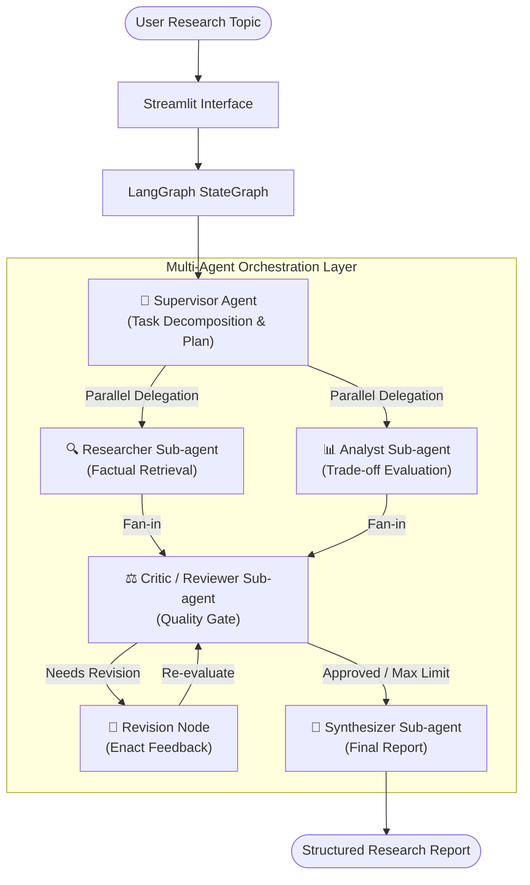
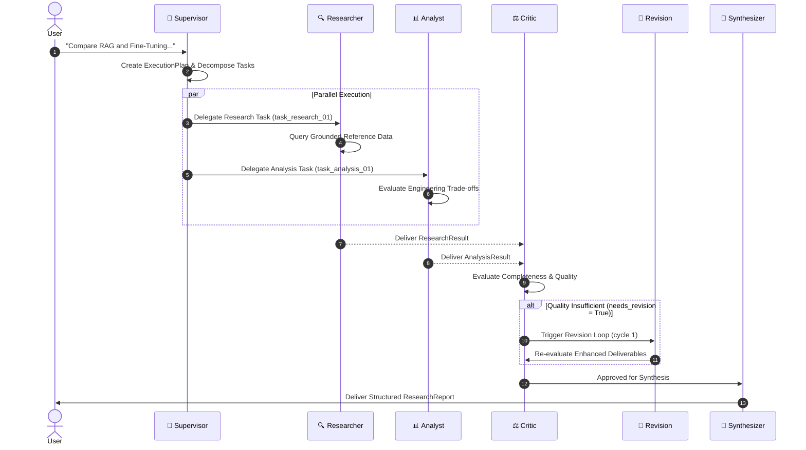
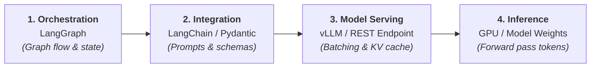

# AgentForge

> **An experimental AI research assistant exploring multi-agent architectures, supervisor-based delegation, sub-agents, LangGraph orchestration, and local LLM inference with vLLM.**

---

## 1. Project Overview

**AgentForge** is a practical engineering experiment built to explore how multi-agent AI systems function in real-world application architectures. 

Instead of relying on an overloaded monolithic prompt, AgentForge demonstrates how a centralized **Supervisor Agent** decomposes a technical research inquiry, delegates bounded sub-tasks to specialized worker sub-agents (**Researcher** and **Analyst**), executes independent tasks in parallel, subjects deliverables to an automated **Critic / Reviewer** quality gate, and synthesizes the final findings into a structured technical research report.

The project also explores decoupled model inference, connecting the agent graph to language models via an OpenAI-compatible interface supporting offline **Mock Mode** (zero credentials needed), hosted LLM endpoints, or high-throughput local model serving powered by **vLLM**.

> **Note on Project Scope**: AgentForge is a personal engineering learning experiment designed to demonstrate architectural decisions, multi-agent patterns, and inference connectivity. It is intentionally kept compact and understandable, and is not an enterprise commercial product.

---

## 2. Why I Built This

I have recently been studying theoretical concepts across modern Agentic AI:
- Supervisor-Worker topologies
- Sub-agent specialization and bounded scopes
- Dynamic task decomposition and delegation
- Graph-based workflow orchestration and conditional state transitions
- LLM model serving, continuous batching, and KV-cache optimization with vLLM

I wanted to move beyond reading papers and tutorials to build a concrete, end-to-end working implementation. I specifically wanted to experience firsthand how state flows through a cyclic graph, how parallel workers coordinate without race conditions, and how an inference engine like vLLM integrates with an orchestration framework like LangGraph.

---

## 3. What I Wanted to Experiment With

1. **Practical Multi-Agent Delegation**: How to make a Supervisor agent actually plan and delegate tasks with real schema contracts rather than merely roleplaying in a text prompt.
2. **Parallel Sub-agent Execution**: How LangGraph handles concurrent branch execution (`supervisor -> [researcher, analyst] -> critic`) and synchronizes state updates.
3. **Automated Quality Loops**: How conditional edges enable self-correction (Critic -> Revision -> Critic) while enforcing hard bounds to prevent infinite loops.
4. **Decoupled Inference Architecture**: Distinguishing the responsibilities of *Orchestration* (LangGraph), *Integration* (LangChain), *Inference* (LLM weights), and *Model Serving* (vLLM).

---

## 4. Core Features

- **Supervisor-Worker Pattern**: Centralized orchestrator generating structured execution plans.
- **Specialized Worker Sub-agents**:
  - `Researcher`: Queries grounded reference data and structures factual specifications.
  - `Analyst`: Evaluates multi-dimensional trade-offs (latency, cost, complexity, freshness).
- **Parallel Execution**: Concurrent execution of non-dependent worker tasks to minimize wall-clock latency.
- **Automated Critic Quality Gate**: Rigorous evaluation of deliverables with a `completeness_score` and conditional revision routing.
- **Bounded Revision Loops**: Safe self-correction capped at a configurable maximum iteration limit (default: 1) to eliminate runaway loops.
- **Grounded Research Tool**: Factual reference lookup that explicitly labels retrieved reference knowledge versus parametric knowledge.
- **Three Inference Modes**:
  - **Mode A (Mock Mode)**: Fully deterministic, offline, zero API keys required.
  - **Mode B (Hosted LLM)**: Connects to any OpenAI-compatible API (OpenAI, Groq, Together).
  - **Mode C (Local vLLM)**: Connects to a local vLLM high-throughput server (`http://localhost:8000/v1`).
- **Observable Delegation Timeline**: Real-time event log tracking actual agent actions, task IDs, and routing decisions.
- **Minimal Streamlit UI**: Dark navy and blue interface displaying live agent statuses, execution plan, timeline, critic score, and final report.

---

## 5. Architecture Overview

AgentForge separates concerns into clear abstraction layers:



---

## 6. Multi-Agent Design

Each agent in AgentForge has a strictly defined boundary, system prompt, and input/output contract:

| Agent | Responsibility | Primary Input | Primary Output |
| :--- | :--- | :--- | :--- |
| **Supervisor** | Problem decomposition, planning, delegation, workflow routing | User query string | `ExecutionPlan` (`List[ResearchTask]`) |
| **Researcher** | Technical facts, architectural definitions, grounded examples | `ResearchTask`, Query | `ResearchResult` (`List[ResearchFinding]`) |
| **Analyst** | Multi-dimensional comparative trade-offs, practical applications | `ResearchTask`, Query | `AnalysisResult` (`List[AnalysisDimension]`) |
| **Critic** | Quality gating, omission checks, contradiction detection | Query, Worker Deliverables | `CriticReview` (`completeness_score`, `needs_revision`) |
| **Synthesizer** | Consolidation, redundancy removal, executive report generation | Approved Deliverables, Critic Review | `ResearchReport` |

---

## 7. Supervisor and Delegation

In AgentForge, delegation is a concrete operational mechanism:
1. The Supervisor analyzes the query and generates an `ExecutionPlan` containing explicit `ResearchTask` Pydantic models.
2. Each task contains a `task_id`, `task_type`, `assigned_agent`, `description`, and `parameters`.
3. The Supervisor emits a `task_delegated` event for each task into the shared state.
4. The LangGraph engine routes execution to the assigned worker nodes.

The Supervisor does not generate research or comparative tables itself; its sole responsibility is coordination and routing.

---

## 8. Sub-agent Responsibilities

- **Researcher (`agents/researcher.py`)**: Uses a lightweight domain knowledge tool (`tools/research_tools.py`) to query technical reference data. Avoids deceptive claims of live web browsing by clearly labeling knowledge sources as *retrieved references* versus *parametric knowledge*.
- **Analyst (`agents/analyst.py`)**: Focuses on deep comparison along four core dimensions:
  1. *Data Freshness & Updatability*
  2. *Latency & Compute Overhead*
  3. *Hallucination Risk & Verifiability*
  4. *Operational & Engineering Complexity*
- **Critic (`agents/critic.py`)**: Evaluates whether the user's objective was satisfied, calculates a numerical `completeness_score` (0.0 to 1.0), and provides actionable revision instructions if gaps are found.
- **Synthesizer (`agents/synthesizer.py`)**: Eliminates redundant information, resolves stylistic inconsistencies, and compiles an executive summary, key findings, comparative analysis, trade-offs, recommendations, and limitations.

---

## 9. Workflow Execution



---

## 10. Parallel Execution

AgentForge exploits graph-level concurrency. In `graph/workflow.py`, the `supervisor` node fans out to both `researcher` and `analyst`:

```python
workflow.add_edge("supervisor", "researcher")
workflow.add_edge("supervisor", "analyst")
```

Because neither worker depends on the other's output, LangGraph executes both nodes concurrently. State updates are combined cleanly:
- `research_result` is written by the Researcher.
- `analysis_result` is written by the Analyst.
- `execution_events` are appended using LangGraph's `Annotated[List[ExecutionEvent], operator.add]` reducer.

Both branches converge at the `critic` node, which pauses execution until both worker deliverables are delivered.

---

## 11. Conditional Handoffs & Loop Prevention

The workflow incorporates a conditional edge following the Critic's review:

```python
def route_after_critic(state: AgentForgeState) -> str:
    settings = get_settings()
    review = state.get("critic_review")
    revision_count = state.get("revision_count", 0)
    max_revisions = settings.max_revision_attempts

    if review and review.needs_revision and revision_count < max_revisions:
        return "revision"
    return "synthesizer"
```

### Preventing Infinite Loops
A major risk in autonomous multi-agent loops is infinite cycling between worker and critic. AgentForge guarantees termination through:
1. **Explicit State Tracking**: `revision_count` is tracked in `AgentForgeState`.
2. **Hard Ceiling**: `MAX_REVISION_ATTEMPTS` (default: 1) caps automatic revision iterations.
3. **Safety Fallback**: Once `revision_count >= MAX_REVISION_ATTEMPTS`, the workflow routes directly to the Synthesizer regardless of the Critic's verdict.

---

## 12. LLM Integration

AgentForge uses **LangChain** (`ChatOpenAI`, `langchain-core`) and **Pydantic v2** to establish strict input/output contracts.

```
Agent Logic
   ↓
LangChain ChatOpenAI
   ↓
with_structured_output(PydanticSchema)
   ↓
OpenAI-Compatible REST API (/v1/chat/completions)
```

To guard against malformed model responses or provider drops, `core/llm.py` implements a robust multi-tier fallback:
1. Native schema-based tool calling via `with_structured_output`.
2. Markdown regex JSON block extraction (` ```json ... ``` `).
3. Plain brace extraction.
4. Graceful fallback to deterministic mock logic if an external endpoint fails unexpectedly.

---

## 13. LLM Inference and vLLM

AgentForge highlights the architectural distinction between orchestration, integration, inference, and model serving:



### Key Conceptual Distinctions
- **Agent Orchestration**: The high-level control logic managing state machines, agent handoffs, cycles, and task coordination (**LangGraph**).
- **LLM Integration**: The client library standardizing prompts, schemas, and model API calls (**LangChain**).
- **LLM Inference**: The low-level mathematical computation executing forward passes through neural network weights to generate tokens.
- **Model Serving**: The infrastructure software exposing high-concurrency HTTP endpoints, scheduling requests, and managing GPU VRAM efficiently (**vLLM**).

### Why vLLM is Valuable for Multi-Agent Workflows
Multi-agent systems generate concurrent request spikes (such as Researcher and Analyst firing simultaneously). Standard inference runtimes suffer from memory fragmentation and sequential queuing. **vLLM** solves this with:
- **PagedAttention**: Treats KV-cache memory as virtual pages, virtually eliminating VRAM fragmentation.
- **Continuous Batching**: Iteration-level scheduling that dynamically batches concurrent agent requests without blocking.

> **vLLM is Optional**: AgentForge does not require a GPU or local vLLM installation. The application runs out-of-the-box in **Mock Mode** or against any remote hosted OpenAI-compatible endpoint.

---

## 14. Execution Modes

| Mode | Credentials | Hardware Required | Typical Use Case |
| :--- | :--- | :--- | :--- |
| **Mode A: Mock Mode** *(Default)* | None | Any CPU | Fast, 100% deterministic local demonstrations and automated tests. |
| **Mode B: Hosted LLM** | API Key | Any CPU | Connecting to OpenAI, Groq, Together AI, or OpenRouter. |
| **Mode C: Local vLLM** | None / Optional | NVIDIA GPU recommended | Local open-weights model inference (e.g. Llama-3.1-8B) at `http://localhost:8000/v1`. |

---

## 15. Technology Stack

- **Language**: Python 3.12+
- **Environment & Package Management**: `uv`
- **Agent Orchestration**: `langgraph>=1.2.0`
- **LLM Integration**: `langchain>=1.4.0`, `langchain-openai>=1.7.0`
- **Data Modeling & Validation**: `pydantic>=2.10.0`, `pydantic-settings>=2.10.0`
- **User Interface**: `streamlit>=1.40.0`
- **HTTP Client & Diagnostics**: `httpx>=0.28.0`
- **Testing**: `pytest>=9.0.0`, `pytest-asyncio>=1.4.0`

---

## 16. Project Structure

```
agentforge/
├── app/
│   ├── __init__.py
│   ├── main.py                  # Streamlit application entry point
│   └── components/
│       ├── __init__.py
│       ├── agent_status.py      # Live agent status indicators
│       ├── timeline.py          # Execution timeline & plan display
│       └── report_view.py       # Critic card & final report view
│
├── agents/
│   ├── __init__.py
│   ├── supervisor.py            # Central orchestrator & delegation planner
│   ├── researcher.py            # Factual retrieval worker sub-agent
│   ├── analyst.py               # Comparative trade-offs worker sub-agent
│   ├── critic.py                # Quality review gatekeeper sub-agent
│   └── synthesizer.py           # Final report compilation sub-agent
│
├── graph/
│   ├── __init__.py
│   ├── state.py                 # Centralized AgentForgeState definition
│   ├── nodes.py                 # LangGraph node implementations
│   └── workflow.py              # StateGraph topology & conditional edges
│
├── core/
│   ├── __init__.py
│   ├── config.py                # Pydantic Settings & environment config
│   ├── inference.py             # Server health diagnostics & abstractions
│   └── llm.py                   # Model integration & mock engine fallbacks
│
├── schemas/
│   ├── __init__.py
│   ├── task.py                  # ResearchTask & ExecutionPlan models
│   ├── responses.py             # AgentResult, CriticReview, ResearchReport
│   └── events.py                # ExecutionEvent observability schema
│
├── tools/
│   ├── __init__.py
│   └── research_tools.py        # Grounded technical reference retriever
│
├── tests/
│   ├── __init__.py
│   ├── test_agents.py           # Unit tests for individual agents
│   ├── test_workflow.py         # End-to-end integration & concurrency tests
│   └── test_inference_config.py # Config validation & health check tests
│
├── docs/
│   ├── architecture.md          # In-depth architectural design document
│   └── INTERVIEW_GUIDE.md       # 15 interview Q&As and elevator pitch
│
├── .env.example                 # Example configuration environment variables
├── .gitignore
├── requirements.txt             # Pip dependency specifications
├── pytest.ini                   # Pytest test configuration
├── README.md
└── LICENSE                      # MIT License
```

---

## 17. Installation

### Prerequisites
- Python 3.11+ or 3.12
- `uv` (recommended) or standard `pip`

### Step 1: Clone Repository
```bash
git clone https://github.com/mohaned/Multi-Agent-Research-Assistant.git agentforge
cd agentforge
```

### Step 2: Create Virtual Environment with `uv`
```bash
uv venv .venv --python python3.12
source .venv/bin/activate
```

### Step 3: Install Dependencies
```bash
uv pip install -r requirements.txt
```

---

## 18. Quick Start

### Run in Mock Mode (Zero Credentials Needed)
```bash
# 1. Activate environment
source .venv/bin/activate

# 2. Launch Streamlit UI
streamlit run app/main.py
```
Open your browser at `http://localhost:8501`. Enter any research topic and click **⚡ Run Multi-Agent Research**.

### (Optional) Serving with Local vLLM
If you have an NVIDIA GPU and wish to experiment with local model serving:
```bash
# In a separate terminal with GPU access:
pip install vllm
python -m vllm.entrypoints.openai.api_server \
    --model meta-llama/Llama-3.1-8B-Instruct \
    --port 8000
```
In AgentForge, set `APP_MODE=vllm` in your `.env` or select **vllm** from the sidebar dropdown.

---

## 19. Configuration

Copy `.env.example` to `.env`:
```bash
cp .env.example .env
```

| Variable | Default | Description |
| :--- | :--- | :--- |
| `APP_MODE` | `mock` | Execution mode: `mock`, `hosted`, or `vllm`. |
| `LLM_PROVIDER` | `openai_compatible` | Provider interface format. |
| `LLM_BASE_URL` | `http://localhost:8000/v1` | Root endpoint for OpenAI-compatible API. |
| `LLM_API_KEY` | *(empty)* | Optional authorization token (required for hosted OpenAI). |
| `LLM_MODEL` | `meta-llama/Llama-3.1-8B-Instruct` | Model identifier passed in requests. |
| `LLM_TEMPERATURE` | `0.2` | Generation sampling temperature (0.0–2.0). |
| `MAX_REVISION_ATTEMPTS` | `1` | Hard ceiling on Critic-initiated revision loops. |
| `LANGSMITH_TRACING` | `false` | Enable distributed LangSmith tracing if desired. |

---

## 20. Example Execution

**User Input Query**:  
`"Compare RAG and Fine-Tuning for a customer support application."`

1. **Supervisor Agent**:
   - Analyzes inquiry.
   - Formulates plan: decomposes into `task_research_01` (factual specifications) and `task_analysis_01` (comparative trade-offs).
2. **Parallel Dispatch**:
   - `Researcher`: Queries grounded reference data for RAG vector search and Fine-Tuning PEFT/LoRA architectures.
   - `Analyst`: Evaluates latency SLAs, training compute, hallucination risk, and customer support scenarios.
3. **Critic Sub-agent**:
   - Evaluates deliverables against original query.
   - Scores completeness at 94%, flags 0 contradictions, and approves for synthesis.
4. **Synthesizer Sub-agent**:
   - Compiles executive summary, comparative findings, engineering trade-offs, and actionable guidance.
5. **Timeline Output**:
   ```
   [10:37:57] Supervisor  → Formulated execution plan with 2 delegated tasks.
   [10:37:57] Supervisor  → Delegated 'research' task (task_research_01) to Researcher.
   [10:37:57] Supervisor  → Delegated 'analysis' task (task_analysis_01) to Analyst.
   [10:37:57] Researcher  → Commenced research task. Consulting domain knowledge tool.
   [10:37:57] Analyst     → Commenced analysis task. Evaluating dimensions and trade-offs.
   [10:37:57] Researcher  → Completed research with 2 key findings from 3 sources.
   [10:37:57] Analyst     → Completed analysis across 4 dimensions with 3 key insights.
   [10:37:57] Critic      → Critique outcome: Approved (Completeness: 94%).
   [10:37:57] Synthesizer → Compiled final research report.
   ```

---

## 21. Testing

The project includes unit and integration tests covering agent planning, tool retrieval, concurrency, and conditional edge safety.

Run the test suite:
```bash
pytest -q
```

Expected output:
```
17 passed in 0.72s
```

Test coverage includes:
- `test_supervisor_task_planning`: Verifies task decomposition and schema validity.
- `test_task_delegation_attributes`: Verifies task IDs and bounded scopes.
- `test_researcher_execution_and_tool_grounding`: Verifies factual grounding tool integration.
- `test_analyst_comparative_dimensions`: Verifies multi-dimensional evaluation.
- `test_critic_approval`: Verifies quality gating and approval path.
- `test_critic_revision_mandate`: Verifies simulated gap detection.
- `test_synthesizer_report_generation`: Verifies executive report compilation.
- `test_full_workflow_execution_mock_mode`: Verifies complete end-to-end graph execution without credentials.
- `test_parallel_worker_execution`: Verifies concurrency ordering in the graph.
- `test_critic_revision_routing_and_recovery`: Verifies conditional looping and re-evaluation.
- `test_maximum_revision_limit_prevents_infinite_loop`: Verifies hard termination safety boundary.
- `test_default_settings_is_mock`: Verifies default configuration safety.
- `test_settings_secret_masking`: Verifies API keys are never exposed in logs or UI.
- `test_inference_health_check_graceful_offline`: Verifies unreachable server handling.

---

## 22. Engineering Decisions and Trade-offs

1. **LangGraph over Linear Chains**:  
   *Decision*: Use LangGraph's `StateGraph` rather than standard LangChain `RunnableSequence`.  
   *Trade-off*: Higher initial boilerplate and state typing requirements, but provides native cyclic loops (Critic feedback) and true parallel branch fan-out.
2. **Centralized Typed State over Ad-hoc Dictionaries**:  
   *Decision*: Use a single typed `AgentForgeState(TypedDict)` with Pydantic models.  
   *Trade-off*: Requires explicit schemas for all agent handoffs, but guarantees type safety, IDE autocompletion, and predictable graph debugging.
3. **Structured Domain Tool over Live Web Scraping**:  
   *Decision*: Use an in-memory structured reference retriever (`KnowledgeRetriever`).  
   *Trade-off*: Does not fetch live arbitrary web pages, but guarantees fast, offline, deterministic factual grounding without fragile external scrapers or API rate limits.
4. **Mock Mode as First-Class Citizen**:  
   *Decision*: Design a rich, deterministic synthetic engine for Mock Mode.  
   *Trade-off*: Adds mock generation code in `core/llm.py`, but guarantees that technical interview demonstrations and CI tests run flawlessly without relying on external network health or paid API tokens.

---

## 23. Limitations

- **Not a Production Multi-Tenant Platform**: Designed for single-session research investigations; does not include authentication, user databases, or long-term vector store persistence.
- **Reference Scope**: The offline knowledge tool covers common AI engineering topics (RAG, fine-tuning, vector search, vLLM, agent patterns). Unrecognized topics fall back to general structured engineering heuristics.
- **Single Revision Cycle Default**: Capped at 1 revision cycle to keep interview demonstrations responsive and prevent token bloat.

---

## 24. What I Learned

- **The Value of State Separation**: Decoupling the worker deliverables into distinct state keys (`research_result`, `analysis_result`) prevented race conditions during parallel execution.
- **The Reality of Model Serving**: Understanding that vLLM is not an agent framework, but a memory-efficient inference server that makes agent swarms viable on GPU hardware.
- **Prompt Specialization**: Sub-agents with short, bounded system prompts produce vastly superior structured outputs compared to a single prompt trying to do everything at once.

---

## 25. Future Improvements

- [ ] Add dynamic tool selection for Researcher (e.g. ArXiv API or DuckDuckGo integration).
- [ ] Add streaming tokens support from vLLM directly into Streamlit components.
- [ ] Implement persistent checkpoints using LangGraph's SQLite checkpointer.
- [ ] Add comparative cost calculators estimating inference tokens per revision cycle.

---
