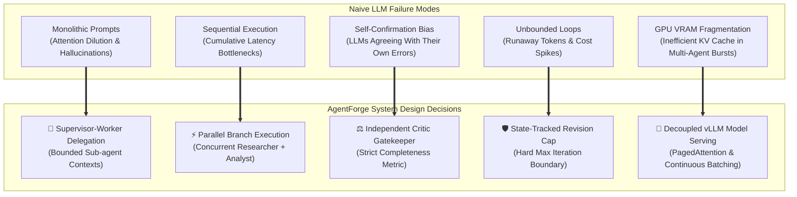
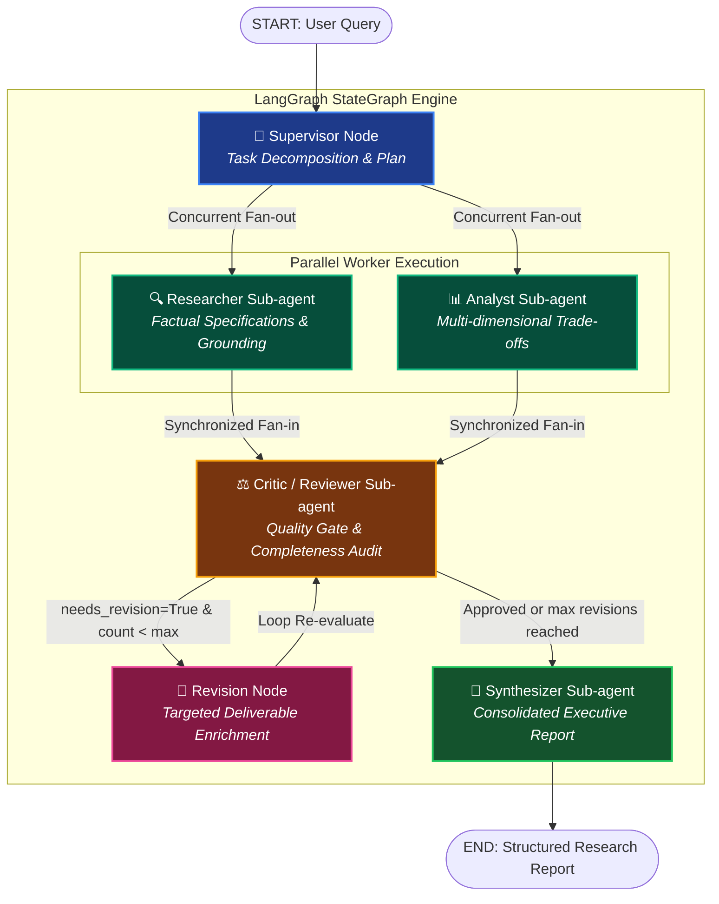
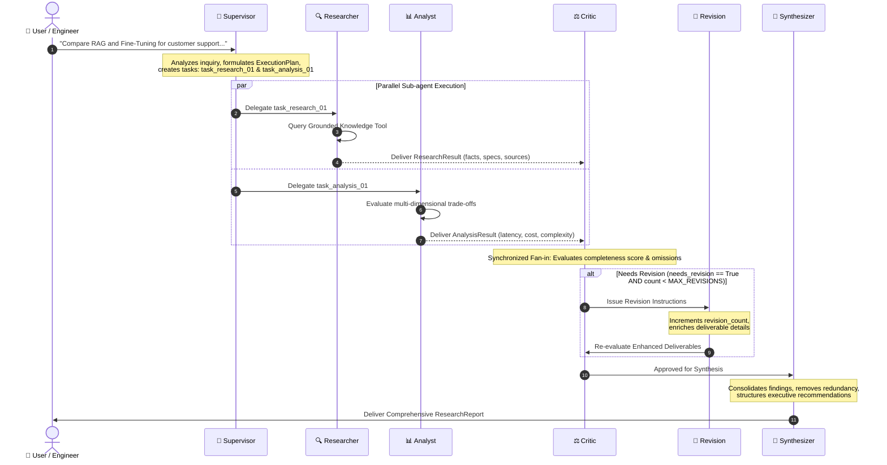
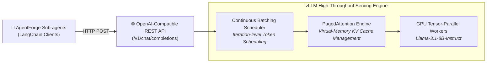

# AgentForge

<div align="center">


<p align="center">
  <b>An experimental multi-agent AI research assistant exploring supervisor-based delegation, sub-agents, LangGraph cyclic orchestration, and high-throughput local LLM inference with vLLM.</b>
</p>

</div>

---

## 1. Project Overview

**AgentForge** is an engineering experiment built to investigate how modern multi-agent AI design patterns and high-performance model serving function in practice.

Rather than relying on an overloaded monolithic prompt or an opaque multi-agent swarm, AgentForge implements a structured **Supervisor-Worker architecture**. A central **Supervisor Agent** decomposes a technical research inquiry, delegates bounded sub-tasks to specialized worker sub-agents (**Researcher** and **Analyst**), executes independent tasks concurrently, subjects deliverables to an automated **Critic / Reviewer** quality gate, and synthesizes the findings into an executive-ready technical report.

The project also decouples the model inference layer from agent orchestration: the application connects to language models via an OpenAI-compatible REST API, supporting offline **Mock Mode** (zero credentials, zero latency), hosted LLM providers, or high-throughput local model serving powered by **vLLM** with PagedAttention.

> **Engineering Notice**: AgentForge is a personal engineering learning experiment designed to demonstrate architectural decisions, state-machine transitions, and inference connectivity. It is intentionally kept compact, transparent, and reproducible.

---

## 2. Why I Built This

I have recently been studying theoretical concepts across modern Agentic AI and LLM systems engineering:
- Hierarchical Supervisor-Worker multi-agent topologies
- Dynamic task decomposition and structured agent delegation
- Graph-based state machine orchestration with cycles and parallel branching
- LLM model serving, continuous batching, and KV-cache optimization with vLLM

I wanted to move beyond passive reading and build a concrete, end-to-end working implementation. Specifically, I wanted to understand:
1. How state flows across concurrent worker branches without race conditions.
2. How to implement self-correcting feedback loops with mathematical safety bounds against infinite execution.
3. The exact architectural line separating *Agent Orchestration* (LangGraph), *Model Integration* (LangChain), and *Model Serving* (vLLM).

---

## 3. System Design: Why These Techniques?

A central motivation of this project is demonstrating **deliberate system design**. Every architectural pattern was chosen to solve a specific engineering failure mode common in naive LLM applications:



---

### Deep-Dive: Architectural Decisions and Trade-offs

#### A. Why Supervisor-Worker over a Decentralized Swarm / Peer-to-Peer?
- **Failure Mode in Swarms**: Decentralized peer-to-peer agent swarms (where agents message each other arbitrarily) suffer from non-deterministic message storms, high coordination overhead, and unpredictable convergence.
- **Why Supervisor-Worker**: A centralized Supervisor acts as a single point of planning and accountability. It analyzes the goal once, constructs an immutable execution plan with unique task IDs, and delegates explicitly. The workers execute within bounded scopes and report back. This guarantees auditable, predictable state transitions suitable for production engineering.

#### B. Why LangGraph over Linear Chains (`RunnableSequence`) or Vanilla Scripts?
- **Failure Mode in Chains**: Standard LangChain chains represent Directed Acyclic Graphs (DAGs). They cannot natively represent cyclic feedback loops (e.g. Critic $\rightarrow$ Revision $\rightarrow$ Critic) or human-in-the-loop interruptions without clumsy custom `while` loops.
- **Why LangGraph**: LangGraph models workflows as explicit state machines (`StateGraph`). It provides:
  1. **Native cyclic graph support** with conditional edges.
  2. **Synchronized parallel execution**: Automatic fan-out and fan-in synchronization.
  3. **Centralized state persistence**: Checkpointing capability and observable state history.
  4. **Typed state reducers**: Eliminates race conditions during concurrent worker state merges.

#### C. Why Concurrent Worker Execution (Researcher & Analyst)?
- **Failure Mode in Sequential Pipelines**: Running Research $\rightarrow$ Analysis $\rightarrow$ Critique sequentially compounds latency. If research takes 3s and analysis takes 3s, total pre-critique latency is 6s.
- **Why Concurrency**: In technical inquiries (e.g. *"Compare RAG vs Fine-Tuning"*), factual architectural discovery and comparative trade-off modeling are orthogonal tasks. By dispatching both nodes concurrently from the Supervisor, total pre-critique wall-clock latency drops to $\max(T_{\text{research}}, T_{\text{analysis}})$, cutting execution time by nearly 50%.

#### D. Why an Independent Critic Node with Bounded Revision?
- **Failure Mode in Single Prompts**: LLMs asked to "critique your own answer" exhibit severe **self-confirmation bias**, routinely rating flawed answers as 10/10. Conversely, naive revision loops risk infinite ping-pong between worker and critic.
- **Why Critic + Hard Bound**:
  1. The Critic is isolated with its own system prompt focused solely on skepticism, gap detection, and contradiction identification.
  2. The Critic computes an objective `completeness_score` (0.0 to 1.0).
  3. The conditional edge `route_after_critic` inspects both `needs_revision` and `revision_count < MAX_REVISION_ATTEMPTS`. Even if the Critic remains unsatisfied, the workflow terminates safely after 1 cycle, preventing token drain and API cost runaway.

#### E. Why Pydantic V2 Schemas for All Inter-Agent Communication?
- **Failure Mode in Loose Strings**: Passing freeform markdown or untyped JSON between agents causes silent downstream failures when a worker omits a key field.
- **Why Pydantic Schemas**: Every handoff is strictly typed ([`ResearchTask`](file:///home/mohaned/Folder%20E/Projects/Multi-Agent%20Research%20Assistant/schemas/task.py), [`ResearchResult`](file:///home/mohaned/Folder%20E/Projects/Multi-Agent%20Research%20Assistant/schemas/responses.py), [`AnalysisResult`](file:///home/mohaned/Folder%20E/Projects/Multi-Agent%20Research%20Assistant/schemas/responses.py), [`CriticReview`](file:///home/mohaned/Folder%20E/Projects/Multi-Agent%20Research%20Assistant/schemas/responses.py), [`ResearchReport`](file:///home/mohaned/Folder%20E/Projects/Multi-Agent%20Research%20Assistant/schemas/responses.py)). If an LLM returns malformed data, schema validation catches it immediately, activating fallback regex parsers or mock generators before corrupting state.

#### F. Why Decouple Inference with vLLM?
- **Failure Mode in Multi-Agent Serving**: Multi-agent applications generate sharp, bursty concurrency (e.g. Supervisor fans out to multiple workers at the exact same millisecond). Standard Hugging Face or naive PyTorch runtimes suffer from **KV-cache memory fragmentation**, wasting up to 60–80% of GPU memory and queuing requests sequentially.
- **Why vLLM**: vLLM introduces **PagedAttention** (managing attention keys and values like virtual memory pages) and **continuous iteration-level batching**. This allows high concurrency with near-zero memory waste on GPU hardware.
- **Decoupled API Standard**: By speaking standard OpenAI-compatible HTTP REST (`/v1/chat/completions`), AgentForge remains 100% agnostic to whether the model is hosted locally on an NVIDIA GPU with vLLM, run in cloud inference (Groq/Together), or tested in zero-cost Mock Mode.

---

## 4. Architectural Layers

AgentForge strictly separates concerns into four modular layers:

```
+--------------------------------------------------------------------------+
| 1. User Interface (Streamlit)                                            |
|    - Reactive UI, Agent Activity Grid, Real-time Delegation Timeline      |
+--------------------------------------------------------------------------+
                                    ↓
+--------------------------------------------------------------------------+
| 2. Agent Orchestration Layer (LangGraph)                                 |
|    - Directed StateGraph, Centralized State Management,                   |
|      Parallel Branching & Fan-in, Conditional Edges                      |
+--------------------------------------------------------------------------+
                                    ↓
+--------------------------------------------------------------------------+
| 3. LLM Integration Layer (LangChain & Pydantic)                          |
|    - Prompt Templates, Schema Enforcers, Structured Output Parsing       |
+--------------------------------------------------------------------------+
                                    ↓
+--------------------------------------------------------------------------+
| 4. LLM Inference & Model Serving Layer (vLLM / Hosted / Mock)           |
|    - Mode A: Mock Mode (Offline, Zero-latency, Deterministic)            |
|    - Mode B: Hosted LLM (OpenAI-compatible REST API)                     |
|    - Mode C: Local vLLM (PagedAttention, Continuous Batching on GPU)     |
+--------------------------------------------------------------------------+
```

### Distinction of Concerns Matrix

| System Layer | Primary Responsibility | Failure Mode Addressed | Technology in AgentForge |
| :--- | :--- | :--- | :--- |
| **Agent Orchestration** | State machines, execution graphs, branch fan-out/fan-in, conditional cycles | Race conditions, chaotic agent loops, uncoordinated state | **LangGraph** |
| **LLM Integration** | Client abstractions, prompt formatting, Pydantic structured output validation | Schema corruption, malformed JSON, provider API drift | **LangChain** (`ChatOpenAI`, `Pydantic V2`) |
| **LLM Inference** | Forward-pass matrix multiplication computing token probabilities on weights | Inability to generate natural language | **Model Weights** (e.g. Llama 3.1) |
| **Model Serving** | Memory scheduling, KV-cache paging, continuous iteration batching, HTTP REST | GPU VRAM fragmentation, queue starvation under concurrency | **vLLM** (`/v1/chat/completions`) |

---

## 5. Multi-Agent Graph Architecture



---

## 6. Agent Roles and Specifications

| Icon & Agent | Module | Primary Responsibility | Input / Output Contract | Tool Grounding |
| :---: | :--- | :--- | :--- | :--- |
| 👑<br/>**Supervisor** | [`agents/supervisor.py`](file:///home/mohaned/Folder%20E/Projects/Multi-Agent%20Research%20Assistant/agents/supervisor.py) | Decomposes goal into discrete tasks; assigns agents; routes workflow based on Critic feedback. | **In**: Query string<br/>**Out**: [`ExecutionPlan`](file:///home/mohaned/Folder%20E/Projects/Multi-Agent%20Research%20Assistant/schemas/task.py) | None (Pure Orchestrator) |
| 🔍<br/>**Researcher** | [`agents/researcher.py`](file:///home/mohaned/Folder%20E/Projects/Multi-Agent%20Research%20Assistant/agents/researcher.py) | Investigates factual specifications, architectures, component details, and benchmark references. | **In**: `ResearchTask`, Query<br/>**Out**: [`ResearchResult`](file:///home/mohaned/Folder%20E/Projects/Multi-Agent%20Research%20Assistant/schemas/responses.py) | [`KnowledgeRetriever`](file:///home/mohaned/Folder%20E/Projects/Multi-Agent%20Research%20Assistant/tools/research_tools.py) |
| 📊<br/>**Analyst** | [`agents/analyst.py`](file:///home/mohaned/Folder%20E/Projects/Multi-Agent%20Research%20Assistant/agents/analyst.py) | Compares trade-offs across latency, compute cost, update freshness, and operational complexity. | **In**: `ResearchTask`, Query<br/>**Out**: [`AnalysisResult`](file:///home/mohaned/Folder%20E/Projects/Multi-Agent%20Research%20Assistant/schemas/responses.py) | Analytical Dimension Matrices |
| ⚖️<br/>**Critic** | [`agents/critic.py`](file:///home/mohaned/Folder%20E/Projects/Multi-Agent%20Research%20Assistant/agents/critic.py) | Evaluates deliverables against user objective; detects omissions; computes `completeness_score`. | **In**: Query, Worker Results<br/>**Out**: [`CriticReview`](file:///home/mohaned/Folder%20E/Projects/Multi-Agent%20Research%20Assistant/schemas/responses.py) | Evaluation Rubric |
| 🔄<br/>**Revision** | [`graph/nodes.py`](file:///home/mohaned/Folder%20E/Projects/Multi-Agent%20Research%20Assistant/graph/nodes.py) | Ingests Critic instructions; enriches deliverables; increments `revision_count`. | **In**: `critic_review`<br/>**Out**: Updated State, `revision_count + 1` | Revision Router |
| 📝<br/>**Synthesizer** | [`agents/synthesizer.py`](file:///home/mohaned/Folder%20E/Projects/Multi-Agent%20Research%20Assistant/agents/synthesizer.py) | Eliminates redundancy; synthesizes findings into an executive summary, trade-offs, and actions. | **In**: Approved Deliverables<br/>**Out**: [`ResearchReport`](file:///home/mohaned/Folder%20E/Projects/Multi-Agent%20Research%20Assistant/schemas/responses.py) | Report Formatter |

---

## 7. Workflow Execution Sequence



---

## 8. State Management and Event Observability

LangGraph coordinates execution through a single centralized typed state ([`AgentForgeState`](file:///home/mohaned/Folder%20E/Projects/Multi-Agent%20Research%20Assistant/graph/state.py)):

```python
class AgentForgeState(TypedDict):
    user_query: str
    execution_plan: Optional[ExecutionPlan]
    assigned_tasks: List[ResearchTask]
    research_result: Optional[ResearchResult]
    analysis_result: Optional[AnalysisResult]
    critic_review: Optional[CriticReview]
    revision_count: int
    final_report: Optional[ResearchReport]
    execution_events: Annotated[List[ExecutionEvent], operator.add]  # Reducer appends events
    errors: List[str]
    force_revision_test: bool
```

### Event-Driven Observability
Rather than dumping unstructured terminal logs or exposing raw hidden chains-of-thought, every node emits structured [`ExecutionEvent`](file:///home/mohaned/Folder%20E/Projects/Multi-Agent%20Research%20Assistant/schemas/events.py) objects. LangGraph's `operator.add` reducer merges these events chronologically:
- `plan_created`
- `task_delegated`
- `task_started`
- `task_completed`
- `evaluation`
- `routing`
- `revision_requested`
- `report_generated`

These events are rendered live in the Streamlit timeline, demonstrating actual multi-agent delegation.

---

## 9. Inference Layer and vLLM Serving

AgentForge features a decoupled inference architecture connecting to models through standard OpenAI-compatible endpoints:



### Why vLLM is Ideal for Multi-Agent Swarms
- **PagedAttention**: Manages Attention KV cache in discrete, non-contiguous physical pages (analogous to virtual memory in OS architecture). This achieves near-zero memory fragmentation.
- **Continuous Batching**: Unlike traditional batching where fast requests wait for slow ones, vLLM dynamically batches requests at the individual iteration step. When parallel agents (Researcher & Analyst) fire concurrent queries, vLLM serves them with maximum GPU saturation.

---

## 10. Execution Modes

| Mode | Required Credentials | Hardware Requirements | Ideal For |
| :--- | :---: | :---: | :--- |
| **Mode A: Mock Mode** *(Default)* | **None** | Any CPU | 100% deterministic, instant interview demonstrations and hermetic automated CI testing. |
| **Mode B: Hosted LLM** | API Key | Any CPU | Remote OpenAI-compatible endpoints (OpenAI, Groq, Together AI, OpenRouter). |
| **Mode C: Local vLLM** | None / Optional | NVIDIA GPU recommended | High-throughput local open-weights model inference (`http://localhost:8000/v1`). |

---

## 11. Technology Stack

<div align="center">

| Technology | Role in AgentForge | System Design Rationale |
| :--- | :--- | :--- |
|  **Python 3.12** | Core Programming Language | High-performance async runtime, typed data structures, and modern standard library features. |
|  **LangGraph** | Multi-Agent Orchestration | Stateful directed graph framework supporting cycles, conditional edges, and parallel fan-out/fan-in. |
|  **LangChain** | Model Integration Layer | Standardizes chat models, structured outputs, message formatting, and prompt templates. |
|  **vLLM** | Model Serving & Inference | High-throughput GPU inference with PagedAttention and continuous batching. |
|  **Pydantic V2** | Schema Contract Validation | Strictly validated input/output schemas preventing malformed JSON corruption across agent transitions. |
|  **Streamlit** | User Interface | Reactive, dark-themed dashboard displaying live agent status cards, timeline, and final reports. |
|  **Pytest** | Automated Testing | Comprehensive unit and integration test suite (17 tests covering planning, concurrency, safety). |
|  **uv** | Package Management | Lightning-fast, deterministic virtual environment and dependency management. |

</div>

---

## 12. Project Structure

```
agentforge/
├── app/
│   ├── __init__.py
│   ├── main.py                  # Streamlit application entry point
│   └── components/
│       ├── __init__.py
│       ├── agent_status.py      # 5-card live agent activity status grid
│       ├── timeline.py          # Supervisor execution plan & delegation timeline
│       └── report_view.py       # Critic evaluation card & final report view
│
├── agents/
│   ├── __init__.py
│   ├── supervisor.py            # Central orchestrator & task decomposition planner
│   ├── researcher.py            # Factual retrieval worker sub-agent
│   ├── analyst.py               # Comparative trade-offs worker sub-agent
│   ├── critic.py                # Quality review gatekeeper sub-agent
│   └── synthesizer.py           # Final report compilation sub-agent
│
├── graph/
│   ├── __init__.py
│   ├── state.py                 # Centralized AgentForgeState TypedDict definition
│   ├── nodes.py                 # LangGraph node implementations
│   └── workflow.py              # StateGraph topology, edges, and conditional routing
│
├── core/
│   ├── __init__.py
│   ├── config.py                # Pydantic Settings & environment validation
│   ├── inference.py             # Server health diagnostics (vLLM & OpenAI)
│   └── llm.py                   # Model integration & mock engine fallbacks
│
├── schemas/
│   ├── __init__.py
│   ├── task.py                  # ResearchTask & ExecutionPlan models
│   ├── responses.py             # AgentResult, CriticReview, ResearchReport models
│   └── events.py                # ExecutionEvent observability schema
│
├── tools/
│   ├── __init__.py
│   └── research_tools.py        # Grounded technical reference retriever
│
├── tests/
│   ├── __init__.py
│   ├── test_agents.py           # Unit tests for agents & Pydantic schemas
│   ├── test_workflow.py         # Concurrency, revision routing & safety limits
│   └── test_inference_config.py # Config validation & health check tests
│
├── docs/
│   ├── architecture.md          # In-depth architectural design document & diagrams
│   └── INTERVIEW_GUIDE.md       # 60s pitch, concepts, & 15 deep interview Q&As
│
├── .env.example                 # Example configuration environment variables
├── .gitignore                   # Ignores virtualenv, caches, and secrets
├── LICENSE                      # MIT License
├── pytest.ini                   # Pytest test configuration
├── README.md                    # Technical documentation
└── requirements.txt             # Pip dependency specifications
```

---

## 13. Installation & Setup

### Prerequisites
- Python 3.11+ or 3.12
- `uv` (recommended) or standard `pip`

### Step 1: Clone Repository
```bash
git clone https://github.com/mohaned/Multi-Agent-Research-Assistant.git agentforge
cd agentforge
```

### Step 2: Create Virtual Environment with `uv`
```bash
uv venv .venv --python python3.12
source .venv/bin/activate
```

### Step 3: Install Dependencies
```bash
uv pip install -r requirements.txt
```

---

## 14. Quick Start

### Run in Mock Mode (Zero Credentials Needed)
```bash
# 1. Activate environment
source .venv/bin/activate

# 2. Launch Streamlit UI
streamlit run app/main.py
```
Open **`http://localhost:8501`** in your browser. Enter any technical topic and click **⚡ Run Multi-Agent Research**.

### (Optional) Local vLLM Inference
To connect AgentForge to a locally served open-weights model:
```bash
# In a separate terminal with an NVIDIA GPU:
pip install vllm
python -m vllm.entrypoints.openai.api_server \
    --model meta-llama/Llama-3.1-8B-Instruct \
    --port 8000
```
Set `APP_MODE=vllm` in your `.env` or select **vllm** from the Streamlit sidebar.

---

## 15. Configuration

Copy `.env.example` to `.env`:
```bash
cp .env.example .env
```

| Variable | Default | Description |
| :--- | :--- | :--- |
| `APP_MODE` | `mock` | Execution mode: `mock`, `hosted`, or `vllm`. |
| `LLM_PROVIDER` | `openai_compatible` | Provider interface format. |
| `LLM_BASE_URL` | `http://localhost:8000/v1` | Root endpoint for OpenAI-compatible API. |
| `LLM_API_KEY` | *(empty)* | Optional authorization token (required for hosted OpenAI). |
| `LLM_MODEL` | `meta-llama/Llama-3.1-8B-Instruct` | Model identifier passed in requests. |
| `LLM_TEMPERATURE` | `0.2` | Generation sampling temperature (0.0–2.0). |
| `MAX_REVISION_ATTEMPTS` | `1` | Hard ceiling on Critic-initiated revision loops. |
| `LANGSMITH_TRACING` | `false` | Enable distributed LangSmith tracing if desired. |

---

## 16. Example Execution Walkthrough

**Inquiry**: `"Compare RAG and Fine-Tuning for a customer support application."`

```
[10:37:57] 👑 Supervisor  → Formulated execution plan with 2 delegated tasks (parallel_research_and_analysis).
[10:37:57] 👑 Supervisor  → Delegated 'research' task (task_research_01) to Researcher.
[10:37:57] 👑 Supervisor  → Delegated 'analysis' task (task_analysis_01) to Analyst.
[10:37:57] 🔍 Researcher  → Commenced research task. Consulting domain knowledge tool.
[10:37:57] 📊 Analyst     → Commenced analysis task. Evaluating dimensions and trade-offs.
[10:37:57] 🔍 Researcher  → Completed research with 2 key findings from 3 sources.
[10:37:57] 📊 Analyst     → Completed analysis across 4 dimensions with 3 key insights.
[10:37:57] ⚖️ Critic      → Critique outcome: Approved (Completeness: 94%).
[10:37:57] 📝 Synthesizer → Compiled final research report: 'Technical Evaluation Report...'.
```

---

## 17. Automated Testing & Verification

AgentForge includes a comprehensive test suite in `tests/`:

```bash
source .venv/bin/activate
pytest -v
```

### Verified Test Suite (17 Tests Passing)
- `tests/test_agents.py`:
  - `test_supervisor_task_planning`: Verifies task decomposition and schema validity.
  - `test_task_delegation_attributes`: Verifies task IDs and bounded scopes.
  - `test_researcher_execution_and_tool_grounding`: Verifies factual grounding tool integration.
  - `test_analyst_comparative_dimensions`: Verifies multi-dimensional evaluation.
  - `test_critic_approval`: Verifies quality gating and approval path.
  - `test_critic_revision_mandate`: Verifies simulated gap detection.
  - `test_synthesizer_report_generation`: Verifies executive report compilation.
- `tests/test_workflow.py`:
  - `test_full_workflow_execution_mock_mode`: Verifies end-to-end graph execution without credentials.
  - `test_parallel_worker_execution`: Verifies concurrency ordering in the graph.
  - `test_critic_revision_routing_and_recovery`: Verifies conditional looping and re-evaluation.
  - `test_maximum_revision_limit_prevents_infinite_loop`: Verifies hard termination safety boundary.
- `tests/test_inference_config.py`:
  - `test_default_settings_is_mock`: Verifies default configuration safety.
  - `test_settings_secret_masking`: Verifies API keys are never exposed in logs or UI.
  - `test_invalid_temperature_validation`: Verifies input validation bounds.
  - `test_invalid_revision_limit_validation`: Verifies revision parameter limits.
  - `test_inference_health_check_graceful_offline`: Verifies unreachable server handling.
  - `test_get_inference_summary_mock_mode`: Verifies diagnostic summaries.

---

## 18. Limitations

- **Not a Production Multi-Tenant Platform**: Designed for single-session technical research investigations; does not include user authentication, billing, or long-term multi-user database storage.
- **Reference Tool Scope**: The in-memory reference retriever covers common AI engineering topics (RAG, fine-tuning, vector search, vLLM, agent patterns). Unrecognized topics fall back to general structured engineering heuristics.
- **Single Revision Cycle Default**: Capped at 1 revision cycle to keep live interview demonstrations fast and prevent token bloat.

---

## 19. Key Learnings

1. **State Isolation is Paramount**: Decoupling worker state keys (`research_result` vs `analysis_result`) prevented race conditions during parallel branch dispatch.
2. **Model Serving vs Orchestration**: vLLM is not an agent framework; it is high-efficiency model serving. Treating inference serving as a distinct layer enables swapping local open models with hosted cloud APIs with zero application code changes.
3. **Specialized Prompts Outperform Monolithic Prompts**: Sub-agents with short, bounded prompts and explicit Pydantic response schemas consistently outperform single prompts attempting to plan, execute, critique, and format simultaneously.

---

## 20. Future Improvements

- [ ] Add dynamic external tool adapters (e.g. ArXiv API and live GitHub repository inspection).
- [ ] Implement streaming token outputs from vLLM directly into Streamlit UI components.
- [ ] Add SQLite state checkpointing for pause-and-resume workflows.
- [ ] Add automatic token cost calculation per revision cycle.

---

## License

This project is licensed under the [MIT License](LICENSE).
