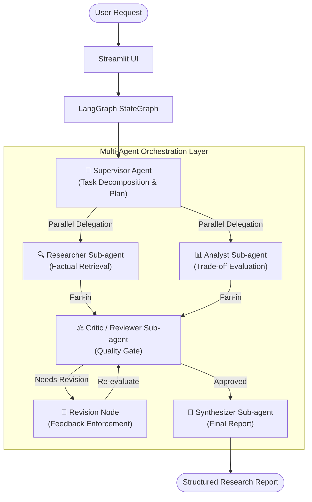
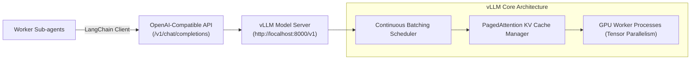

# AgentForge Architecture Document

## 1. System Overview

**AgentForge** is an experimental multi-agent AI research assistant designed to evaluate and demonstrate core patterns of agentic engineering:
- **Supervisor-Worker Architecture**: A central supervisor coordinating specialized worker sub-agents.
- **Explicit Agent Delegation**: Dynamic task decomposition and structured assignment.
- **Parallel Execution**: Concurrent execution of independent sub-agents (Researcher and Analyst).
- **Conditional Routing**: Quality evaluation by a Critic sub-agent determining whether to proceed to synthesis or execute a bounded revision cycle.
- **Decoupled Inference Layer**: Support for offline deterministic execution (Mock Mode), remote OpenAI-compatible endpoints, and high-throughput local model serving with **vLLM**.



---

## 2. Architectural Layers

AgentForge strictly separates concerns across four distinct abstraction layers:

```
+--------------------------------------------------------------------------+
| 1. User Interface (Streamlit)                                            |
|    - Reactive UI, Agent Activity Grid, Real-time Delegation Timeline      |
+--------------------------------------------------------------------------+
                                    ↓
+--------------------------------------------------------------------------+
| 2. Agent Orchestration Layer (LangGraph)                                 |
|    - Directed StateGraph, Centralized State Management,                   |
|      Parallel Branching & Fan-in, Conditional Edges                      |
+--------------------------------------------------------------------------+
                                    ↓
+--------------------------------------------------------------------------+
| 3. LLM Integration Layer (LangChain & Pydantic)                          |
|    - Prompt Templates, Schema Enforcers, Structured Output Parsing       |
+--------------------------------------------------------------------------+
                                    ↓
+--------------------------------------------------------------------------+
| 4. LLM Inference & Model Serving Layer (vLLM / Hosted / Mock)           |
|    - Mode A: Mock Mode (Offline, Zero-latency, Deterministic)            |
|    - Mode B: Hosted LLM (OpenAI-compatible REST API)                     |
|    - Mode C: Local vLLM (PagedAttention, Continuous Batching on GPU)     |
+--------------------------------------------------------------------------+
```

### Distinction of Concerns

| Layer | Responsibility | Technology in AgentForge |
| :--- | :--- | :--- |
| **Agent Orchestration** | Manages execution order, state transitions, cycles, and multi-agent coordination | **LangGraph** |
| **LLM Integration** | Bridges application logic to language models via unified interfaces and structured outputs | **LangChain** (`ChatOpenAI`, `Pydantic`) |
| **LLM Inference** | Performs token generation via neural network forward passes over model weights | **LLM Engine** |
| **Model Serving** | Exposes high-concurrency HTTP/gRPC APIs, manages KV-cache memory, and batches requests | **vLLM** / **TGI** |

---

## 3. Multi-Agent Design & Roles

### A. Supervisor Agent (`agents/supervisor.py`)
- **Role**: Central orchestrator.
- **Input**: User query string.
- **Output**: `ExecutionPlan` containing decomposed `ResearchTask` records.
- **Behavior**: Rather than solving the question directly, the Supervisor formulates an objective, selects required sub-agents, assigns task IDs, and sets parameters. It also evaluates Critic verdicts for conditional routing.

### B. Researcher Sub-agent (`agents/researcher.py`)
- **Role**: Specialized worker for factual investigation and technical specifications.
- **Tool Grounding**: Integrates `KnowledgeRetriever` (`tools/research_tools.py`) to query grounded technical references.
- **Behavior**: Extracts architectural mechanisms, component definitions, and concrete examples. Explicitly labels retrieved reference facts vs model-generated knowledge to avoid false claims of web browsing.
- **Output**: Structured `ResearchResult`.

### C. Analyst Sub-agent (`agents/analyst.py`)
- **Role**: Specialized worker for multidimensional trade-off evaluation.
- **Behavior**: Evaluates options across dimensions:
  1. Data Freshness & Update Latency
  2. Latency & Compute Overhead
  3. Hallucination Risk & Verifiability
  4. Operational & Engineering Complexity
- **Output**: Structured `AnalysisResult`.

### D. Critic / Reviewer Sub-agent (`agents/critic.py`)
- **Role**: Quality gatekeeper and validation check.
- **Behavior**: Evaluates research and analysis against the initial query. Identifies omissions, contradictions, and computes a `completeness_score` (0.0 to 1.0).
- **Control Flow**: If `needs_revision=True` and `revision_count < MAX_REVISION_ATTEMPTS`, triggers the `revision` node. Otherwise, approves for synthesis.
- **Safety**: Hard cap of `MAX_REVISION_ATTEMPTS` (default 1) prevents runaway execution loops and excessive API costs.

### E. Synthesizer Sub-agent (`agents/synthesizer.py`)
- **Role**: Consolidator and report compiler.
- **Behavior**: Ingests approved research findings, trade-offs, and critic assessments to compile an executive-ready `ResearchReport`.
- **Output**: Structured `ResearchReport` containing:
  - Executive Summary
  - Key Findings
  - Comparative Analysis
  - Engineering Trade-offs
  - Actionable Recommendations
  - Scope Boundaries & Limitations

---

## 4. State Management & Observability

### Centralized State (`AgentForgeState`)

LangGraph manages a single shared state dictionary across all nodes:

```python
class AgentForgeState(TypedDict):
    user_query: str
    execution_plan: Optional[ExecutionPlan]
    assigned_tasks: List[ResearchTask]
    research_result: Optional[ResearchResult]
    analysis_result: Optional[AnalysisResult]
    critic_review: Optional[CriticReview]
    revision_count: int
    final_report: Optional[ResearchReport]
    execution_events: Annotated[List[ExecutionEvent], operator.add]
    errors: List[str]
    force_revision_test: bool
```

### Event-Driven Observability

AgentForge avoids opaque chain-of-thought logging. Instead, each node emits structured `ExecutionEvent` objects that are accumulated via LangGraph's append-reducer (`operator.add`):
- `plan_created`
- `task_delegated`
- `task_started`
- `task_completed`
- `evaluation`
- `routing`
- `revision_requested`
- `report_generated`

These events are rendered in the Streamlit UI to show an audit trail of agent delegation.

---

## 5. Parallel Execution and Fan-In Synchronization

In `graph/workflow.py`:
1. `workflow.add_edge(START, "supervisor")`
2. `workflow.add_edge("supervisor", "researcher")`
3. `workflow.add_edge("supervisor", "analyst")`
4. `workflow.add_edge("researcher", "critic")`
5. `workflow.add_edge("analyst", "critic")`

Because `researcher` and `analyst` do not depend on each other's outputs, LangGraph dispatches both nodes concurrently. LangGraph's engine synchronizes the graph and only invokes `critic` once both branches have returned their state updates.

---

## 6. Inference Layer & vLLM Architecture

AgentForge can connect to any OpenAI-compatible inference server, with first-class support for **vLLM**:



### Why vLLM for Agentic Applications?
Multi-agent systems generate bursts of concurrent requests (e.g. Researcher and Analyst executing in parallel). Traditional inference runtimes (like Hugging Face Transformers) suffer from:
1. **KV Cache Fragmentation**: Static memory allocation wastes up to 60-80% of GPU VRAM.
2. **Request Queuing**: Monolithic batching causes fast requests to wait for slow ones.

vLLM resolves these bottlenecks via:
- **PagedAttention**: Manages KV cache memory in non-contiguous virtual pages, virtually eliminating internal fragmentation.
- **Continuous (Iteration-level) Batching**: Dynamically joins and finishes requests on every token step, maximizing GPU saturation during parallel agent fan-outs.
